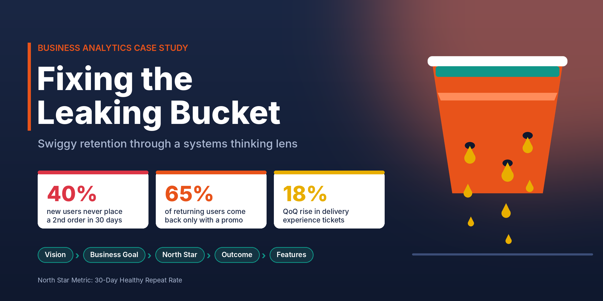

<h1 align="center">Swiggy — Fixing the Leaking Bucket: A Systems Thinking Case Study</h1>

<p align="center">
  
  
  
  
</p>

<p align="center">
  
</p>

## Overview

Swiggy is a top food delivery app in India, and despite millions of orders a day it faces a classic "leaking bucket" problem: many customers order once or twice and then disappear, while money keeps being spent to attract new users. This case study analyses the problem as a business analyst would, before any feature is built or campaign is launched, working through systems mapping → feedback loops → success definition → strategy cascade → outcome mapping, using systems thinking, a North Star Metric, leading/lagging indicators and the strategy cascade.

## The Problem

Swiggy's retention team flagged five signals:

| Signal | Value |
|---|---|
| New users who don't order again within 30 days | **40%** |
| Returning users who come back only when a promo code is offered | **65%** |
| Rise in delivery-experience support tickets (QoQ) | **18%** |
| Shared success metric between restaurant and customer teams | **None** (silos) |
| Current growth goal | **Orders per day** — looks healthy while revenue per user falls |

Each team optimises its own piece of the system and nobody owns the whole.

## Frameworks Applied

| Framework | Used for |
|---|---|
| Systems thinking | Mapping key players (customers, marketing, restaurants, delivery fleet, onboarding & CX teams), how they connect, and what the system should do |
| Feedback loops | Contrasting the current vicious loop with a virtuous loop to design |
| North Star Metric | Replacing the vanity metric "orders per day" |
| Leading vs. lagging indicators | Separating early-warning signals from confirmation signals |
| Strategy cascade | Taking the vision down to a product outcome and features |
| Outcome mapping (ICE prioritisation) | Testing assumptions and prioritising the core opportunity |

## Approach

1. **System Map** — Showed that discounts bring users in while bad deliveries push them out, so marketing is over-compensating for poor service. The goal is to move from a "Subsidy Engine" to a "Reliable Convenience Engine".
2. **Feedback Loops** — Contrasted the current vicious loop with a virtuous one built on reliability (below).
3. **North Star Metric** — Critiqued "orders per day" and replaced it with the **30-Day Healthy Repeat Rate**: the % of new users who place 2+ orders within 30 days *without* a promo code.
4. **Indicators** — Listed leading and lagging indicators (below).
5. **Strategy Cascade** — Vision → Business Goal → North Star Metric → Product Outcome → Features.
6. **Outcome Mapping** — Mapped the "Frictionless First Order" opportunity with assumptions and an ICE score.

## Key Insights

- **The problem is systemic, not a marketing failure** — The 40% first-month drop-off and the 18% rise in delivery tickets point to delivery experience, not demand, as the leak.
- **Orders per day is a vanity metric** — It can be inflated by discount campaigns and hides falling revenue per user; the business gets busier, not healthier.
- **Discounts feed a vicious loop** — High churn → more discount promos → only deal-hunters return (65% need a promo) → low loyalty and lifetime value → churn again.
- **Reliability can reverse the loop** — A high Perfect Order Rate builds trust and habit, habit makes users less price-sensitive, and the resulting promo savings can be reinvested in service quality.
- **Early signals beat late reports** — Perfect Order Rate and Day 1–7 app opens warn of churn weeks before MAU churn or revenue retention show it.

| Type | Indicators |
|---|---|
| Leading | **Perfect Order Rate** (on-time, correct, highly rated) · **App opens in Days 1–7** |
| Lagging | **Monthly Active User churn** · **Net Revenue Retention** |

**Strategy cascade**

| Level | Definition |
|---|---|
| Vision | India's most trusted hyperlocal companion |
| Business goal | Earn habits, not just orders |
| North Star Metric | 30-Day Healthy Repeat Rate |
| Product outcome | Convert 15% more first-timers into Power Users (4+ orders in Month 1) |
| Features | "Premium First 3 Orders" path (top-rated restaurants and delivery partners) + 30-day Free Delivery Trial after Order #1 |

**Core opportunity mapped — "Frictionless First Order":** eliminate first-order disappointment for new customers.

| ICE factor | Rating | Reasoning |
|---|---|---|
| Impact | High | Directly tackles the 40% churn problem |
| Confidence | Medium | A pilot is needed to confirm the lifetime-value gain outweighs added logistics cost |
| Ease | Low | Onboarding and Logistics teams must share logic, and they are currently siloed |

Key assumptions: users with zero issues in their first 2 orders are 3× more likely to become long-term customers; matching new users with top-rated delivery partners cuts support tickets and raises repeat orders; and the Order 1 → Order 2 drop-off is driven mainly by a bad experience, not lack of intent.

## Recommendations

| # | Recommendation |
|---|---|
| 01 | Treat retention as a systemic problem and fix the delivery experience first |
| 02 | Replace "orders per day" with the 30-Day Healthy Repeat Rate as the North Star Metric |
| 03 | Monitor leading indicators (Perfect Order Rate, Day 1–7 app opens) before users churn |
| 04 | Keep the strategy flowing in order: Vision → Goal → Metric → Outcome → Feature |
| 05 | Prioritise a guaranteed perfect first experience, piloting it first to validate cost against lifetime value |

## Repository Structure

```
swiggy-retention-case-study
├── Swiggy_Case_Study_V2_Updated.pdf   ← Full case study deck (9 slides)
├── cover.png                          ← Repo cover image
└── README.md
```

---

## About Me

**Anmol Agarwal**
Business Analyst

[](https://www.linkedin.com/in/anmol-agarwal123/)
[](https://github.com/Anmolagarwal19)
[](mailto:agarwalanmol799@gmail.com)

*If this project was useful, a star on the repo is appreciated — feel free to reach out for feedback, questions, or opportunities.*
